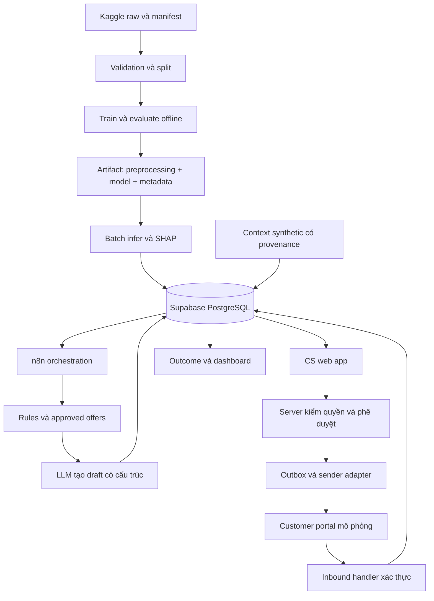
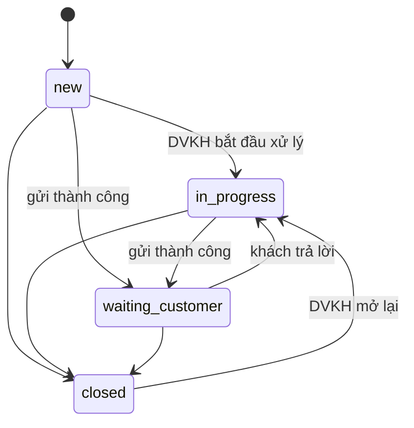
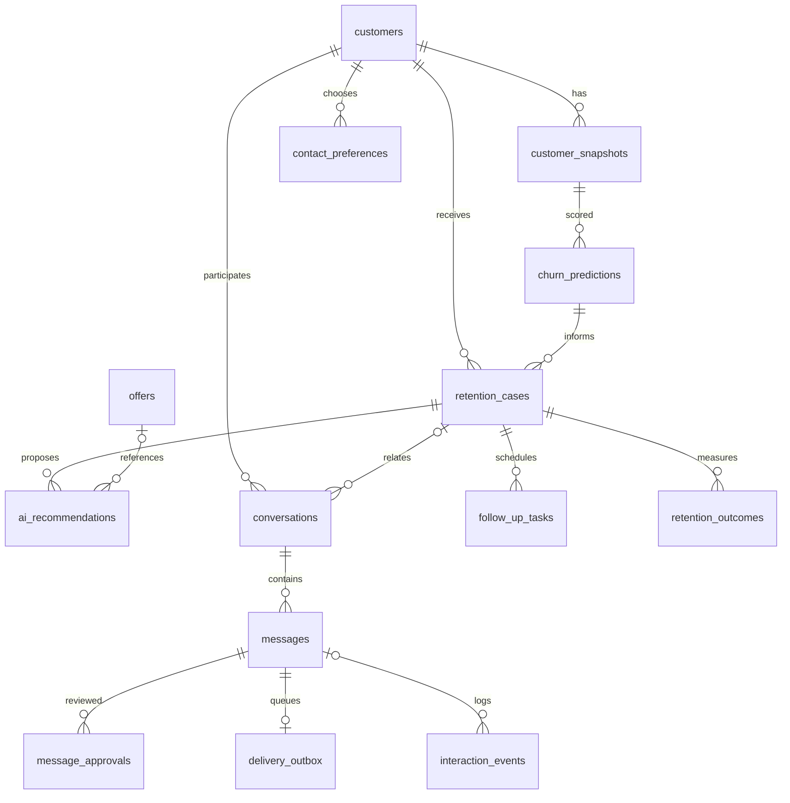

# Thiết kế hệ thống

Cập nhật: 17/10/2026. Trạng thái: draft.

Nguồn chuẩn về phạm vi, kiến trúc, chat/database và hợp đồng tích hợp. Chưa triển khai code hoặc database. Workflow cụ thể xem [n8n](../n8n/README.md).

**Yêu cầu ngôn ngữ — 17/10/2026:** sản phẩm demo phải bằng tiếng Anh theo yêu cầu giảng viên. Áp dụng cho toàn bộ navigation, label, trạng thái, bộ lọc, form, help text, empty/loading/error, AI explanations, action recommendations, message drafts, call scripts, follow-up và portal chat. Staff-facing text phải dễ hiểu bằng tiếng Anh, không chỉ đổi tên nút. LLM workflow đặt output language là English và kiểm tra dữ liệu/thứ hạng không đổi khi diễn giải. Tên riêng, thương hiệu và giá trị dữ liệu gốc không phải nội dung cần dịch tùy tiện; tiền tệ vẫn VND, lưu giờ UTC và hiển thị giờ địa phương theo thiết kế. Tài liệu thiết kế này được phép tiếp tục tiếng Việt. Hỗ trợ đa ngôn ngữ không nằm trong MVP; kênh thật cho khách Việt sẽ cần cấu hình riêng khi được yêu cầu.

## Quyết định bước 1 đã chốt ngày 17/10/2026

Các mục dưới đây ghi nhận câu trả lời trực tiếp của leader; rule số giờ được tách rõ khỏi các quyết định đã xác nhận.

| Hạng mục | Quyết định |
|---|---|
| Kịch bản kỳ dự báo | Nhận batch demo ngày 01/10/2026, dự báo churn trong tháng 10/2026. Tháng 9 là bằng chứng đặt bài toán, không phải kết quả của can thiệp tháng 10 |
| Vai trò | Agent chỉ thao tác case được giao; Supervisor xem toàn pilot, phân công lại và xử lý ngoại lệ. Portal chỉ thấy hội thoại của đúng khách |
| Phê duyệt | Agent được xem/sửa/tự duyệt và gửi trong policy; ngoại lệ vượt hạn mức cần Supervisor. Nội dung hoặc offer thay đổi sau duyệt cần revision và approval mới |
| Quyền AI | AI giải thích, đề xuất, soạn tin/reply và kịch bản gọi trước; nhân viên review mọi nội dung/hành động trước thực hiện. Không tự động gửi tin sau lần duyệt đầu |
| Hàng chờ | Gợi ý phân công theo tải; Supervisor được đổi. Ưu tiên risk + thời gian chờ + nhắc đến hạn. Không cần xây quản lý ca làm việc trong MVP |
| Catalog | Chuẩn bị tài liệu phương án/ưu đãi đã duyệt trước. AI chỉ chọn option đủ điều kiện. Nội dung catalog sẽ viết nháp sau và giao thành viên chatbot review; chưa có catalog thì không tự áp dụng ưu đãi tài chính |
| Kênh demo | Mặc định hiển thị Zalo; Channel selector có thể có Zalo, Messenger, Web Chat. Mọi lựa chọn đều dùng cùng transport chatbot mô phỏng, không kết nối provider thật |
| Nhắc và tin mới | Nhắc khi quá thời gian chưa reply và thông báo khi khách nhắn; đề xuất UX chuông góc trên bên phải + badge + danh sách + toast ngắn |
| Mốc nhắc | Leader chưa khóa 3 hay 24 giờ, nghiêng về 3 giờ. Đặt thời lượng cấu hình được, mặc định làm việc **3 giờ** là đề xuất của AI, không phải SLA công ty. Có thể đổi 24 giờ mà không sửa workflow |
| Case/outcome | Trạng thái liên hệ, trạng thái hồ sơ và kết quả churn tách riêng; đóng case không tự tính retained |
| Mockup | Leader duyệt bộ English làm baseline. Khi code bổ sung Channel, notification bell, kỳ tháng 10 và thời lượng nhắc cấu hình; không cần thêm trang |

### Kỳ snapshot/model v2

Theo yêu cầu mới của leader: dùng LightGBM categorical native, snapshot cuối mỗi tháng 2026 và target churn tháng kế tiếp. Với batch 01/10 dự báo October, snapshot là trạng thái cuối 30/09, không mâu thuẫn kỳ can thiệp đã chốt. Nhãn October chưa đầy đủ ở ngày 17/10, giữ Unknown. Chi tiết temporal split, sample và các nhóm tạm tại [Data/ML](DATA_ML.md). Không cần one-hot thủ công, cũng không suy ra LightGBM hơn CatBoost khi chưa benchmark.

### Kỳ can thiệp và dữ liệu lịch sử

Kỳ tháng 10 theo giờ Asia/Ho_Chi_Minh: bắt đầu 01/10/2026 00:00, kết thúc 01/11/2026 00:00 (cận trên không bao gồm); lưu bằng UTC trong database. Dùng `prediction_period_start/end` và `batch_issued_at` thay vì tự coi đây là 30 ngày trượt. Đây là mốc của kịch bản demo; nếu public dataset không có thời gian thì snapshot/horizon thật vẫn unknown và output được gắn rõ là minh họa.

### Zalo trên giao diện, chatbot mô phỏng ở phía sau

Hiển thị `Channel: Zalo` mặc định; dropdown cho phép chọn các nhãn kênh khác. Cạnh tên kênh luôn có `Simulated` hoặc `Demo channel · No live connection`. Số lượng kênh là lựa chọn hiển thị, không đòi ba tích hợp. Lưu tách `selected_channel` và `transport=mock`; sender, inbound và receipt là của sandbox. Receipt mô phỏng không được ghi thành Zalo delivered/read thật.

Chọn kênh nào cũng mở hội thoại demo đúng customer/case; không đưa các khách vào một phòng chat chung. Đổi nhãn kênh không sửa metadata của tin cũ hoặc bỏ approval. Opt-out và contact_allowed vẫn được kiểm tra. Portal mô phỏng chạy độc lập với giao diện DVKH, không cần sao chép giao diện chính thức Zalo.

### Trung tâm thông báo và nhắc chăm sóc

**UX AI đề xuất:** chuông cố định ở header góc trên bên phải, cạnh avatar; badge unread và dropdown `Notifications`. Toast xuất hiện ngay dưới header bên phải khi có sự kiện mới, không tự mở/che trình soạn tin. Hai loại chính:

- `New customer message`: tên/ref demo, preview phù hợp quyền, thời điểm; bấm mở đúng hội thoại/case.
- `Follow-up due`: khách/case, thời gian chờ và thao tác `Open case`, `Snooze` hoặc ghi đã xử lý.

Thông báo lưu bền, không chỉ là toast; có read/unread riêng. Chỉ staff được phân công và Supervisor đúng phạm vi nhận/xem. Đánh dấu đã đọc không đồng nghĩa xử lý xong lịch nhắc. Mất kết nối/đăng nhập lại vẫn đọc được các mục còn chờ; không cần push ra điện thoại/email trong MVP.

Nhắc đếm từ tin outbound đã gửi thành công gần nhất đang chờ phản hồi của khách, không từ lúc tạo AI draft hoặc phê duyệt. Mặc định làm việc 3 giờ nhưng config có thể là 24 giờ hoặc giờ hẹn nhân viên chọn. Tin gửi mới cập nhật mốc chờ, không tạo nhiều nhắc trùng cho một chuỗi trao đổi; khách reply thì hủy nhắc im lặng cũ và tạo thông báo tin mới. Agent có thể snooze/đặt lịch riêng. Case đóng/opt-out dừng nhắc liên hệ chủ động tương ứng. Tin mới không tự gửi câu trả lời AI.

Worker phải recheck reply, opt-out, case state và mốc gửi trước tạo nhắc. Unique key theo case/conversation, sự kiện nguồn và loại nhắc để chống lặp. Giới hạn số lần liên hệ/khung giờ sẽ là policy cấu hình trong bước 3/6; chưa khóa con số, tuyệt đối không dựa vào thông báo để tự gửi/gọi. Demo tăng tốc thời gian phải có nhãn; không cộng một nhắc làm bằng chứng khách đã được liên hệ.

### Đóng hồ sơ khác với kết quả giữ chân

Ghi ba lớp dữ liệu độc lập:

| Lớp | Ví dụ English UI | Ý nghĩa |
|---|---|---|
| Kết quả lần liên hệ | Not contacted, No response, Replied, Call completed, Customer declined | Đã làm gì và khách phản hồi ra sao; không suy ra churn |
| Trạng thái case | Open, Awaiting reply, Follow-up due, Waiting on external support, Closed | Hồ sơ còn công việc DVKH hay đã kết thúc; nhóm trạng thái ở UI ánh xạ lifecycle có kiểm soát |
| Outcome theo kỳ | Unknown, Churned, Active at period end | Tình trạng sử dụng dịch vụ trong kỳ mục tiêu có nguồn; tên Active at period end rõ hơn một nhãn “AI retained” |

Agent đóng case phải chọn lý do và ghi chú phù hợp: xử lý chăm sóc hoàn tất, khách từ chối, không tiếp cận được theo policy, khách yêu cầu ngừng liên hệ hoặc xác nhận churn. Chuyển yêu cầu kỹ thuật thường giữ case mở/chờ thông tin nếu DVKH còn phải theo dõi; receipt gửi chỉ chứng minh đã bàn giao, không chứng minh đã khắc phục. Đóng case không xóa hội thoại, nhắc đã xử lý hoặc lịch sử duyệt.

Outcome có `period_start/end`, ngày quan sát, nguồn/evidence, người hoặc service ghi nhận và `is_simulated`. Chưa có dữ liệu đúng kỳ: `Unknown` và `churned=null`, dù case đã đóng. Đã có bằng chứng ngừng dịch vụ trong tháng mục tiêu có thể ghi Churned trước khi hết tháng. Active at period end chỉ ghi sau kỳ quan sát khi xác minh khách không churn trong kỳ; một câu “tôi sẽ tiếp tục dùng” hoặc trạng thái active giữa tháng chưa đủ.

Ví dụ kịch bản tháng 10:

| Tình huống | Case/contact | Outcome |
|---|---|---|
| 02/10 khách đồng ý được hỗ trợ | Replied; case còn mở hoặc hoàn tất theo công việc | Unknown; chưa hết kỳ |
| 05/10 DVKH hoàn tất chăm sóc | Closed, reason Care completed | Unknown; vẫn chờ theo dõi dịch vụ |
| 12/10 có dữ liệu hủy dịch vụ hiệu lực trong tháng | Churned, đóng nếu không còn công việc | Churned với nguồn/observed_at; dữ liệu demo có nhãn |
| Sau 01/11 xác minh không churn trong tháng 10 | Case có thể đã đóng từ trước | Active at period end, không tự nhận là nhờ hệ thống |
| Chỉ có request kỹ thuật đã gửi hoặc không liên hệ được | Waiting/Closed theo lý do | Unknown nếu chưa có dữ liệu dịch vụ |

Ngày 17/10 chưa thể ghi nhận kết quả giữ chân cả tháng 10 là đã quan sát. Nếu demo cho thấy mốc sau 01/11 hoặc giả lập churn thì công bố là mô phỏng, không phải kết quả thật. Dashboard tách số case hoàn tất, liên hệ thành công, offer accepted và outcome của cohort đủ kỳ; không gọi active rate là incremental retention hoặc ROI của giải pháp khi chưa có đối chứng.

---

## Đặc tả hệ thống v0.1

Ngày cập nhật: 18/10/2026. Trạng thái: contract MVP đã triển khai và kiểm thử database local; chưa xác minh cloud. Tên: **AI-Powered Telecom Customer Retention**.

### 1. Mục tiêu và bài toán

Giúp quản lý và nhân viên CS quyết định khách hàng nào nên được chăm sóc trước, hành động nào phù hợp và khi nào cần chuyển bộ phận kỹ thuật. Hệ thống nối Data Analytics, CS, Technical Support, Retention/Marketing và Finance bằng một quy trình có dữ liệu và nhật ký quyết định.

**Cập nhật phạm vi ngày 17/10/2026:** bài toán xuất phát từ dịch vụ Internet FPT Telecom trên toàn quốc, với số churn lũy kế 2026 tăng 20% so với cùng kỳ theo thông tin người dùng cung cấp. Bình Dương là case điển hình và địa bàn thí điểm do mức gia tăng tỷ lệ rời mạng cao nhất trong hệ thống theo cùng nguồn, không phải toàn bộ phạm vi vấn đề. Pilot là cơ sở xem xét mở rộng, chưa cam kết triển khai toàn quốc. Doanh nghiệp mới áp dụng model trong những tháng gần đây; theo thông tin người dùng cung cấp, danh sách điểm >500 dự báo churn trong cùng tháng được gửi đầu tháng cho DVKH chăm sóc. Đóng góp trung tâm của dự án là hệ thống phối hợp liên phòng ban từ cảnh báo đến outcome. ML public-data trong prototype chỉ mô phỏng nguồn prediction, không phải thay thế model nội bộ hoặc tuyên bố tái tạo nó. Nguồn và giả định định lượng xem [Problem nội bộ](PROBLEM.md).

Giữ ý tưởng Predict - Explain - Recommend - Approve - Engage - Measure của brainstorm. Điều chỉnh trọng tâm từ chatbot gửi ưu đãi sang hỗ trợ ra quyết định giữ chân có giới hạn năng lực và ngân sách. Khách rủi ro cao không đồng nghĩa chắc chắn thuyết phục được; nhiều trường hợp cần sửa dịch vụ hoặc giải thích hóa đơn thay vì giảm giá.

Không cam kết đạt điểm tối đa hoặc cải thiện retention khi chưa có bằng chứng. Mục tiêu học thuật là lập luận kinh doanh thuyết phục và chứng minh tính khả thi; mục tiêu sản phẩm là một luồng hoàn chỉnh có thể mở rộng.

### 2. Phạm vi đề xuất

MVP: nhập prediction hiện có qua adapter và kiểm tra schema; xếp hàng ưu tiên; tạo hồ sơ chăm sóc và đề xuất; nhân viên duyệt; gửi yêu cầu hỗ trợ sang bộ phận kỹ thuật khi cần; gửi/nhận qua customer portal mô phỏng; theo dõi trạng thái chăm sóc, follow-up và outcome. Nếu không truy cập được model nội bộ, dùng pipeline public-data để cung cấp prediction demo; train/evaluate là thành phần hỗ trợ, không phải mục tiêu kinh doanh trung tâm. Chỉ cung cấp SHAP khi có model/feature/explainer phù hợp; danh sách chỉ có score không đủ để suy ra SHAP.

Chưa làm: gửi Zalo/Messenger thật, tự phê duyệt ưu đãi, autonomous agent đàm phán, fine-tune LLM, hệ microservices, forecasting 30 ngày khi dữ liệu không hỗ trợ, ước lượng causal uplift từ nhãn churn thông thường. Không viết đầy đủ frontend trước khi duyệt mockup.

**Giao diện tinh gọn ngày 17/10/2026:** 3 màn hình: (1) hàng chờ gộp tổng quan/khách hàng/case; (2) hồ sơ xử lý gộp context, AI draft, phê duyệt, phối hợp kỹ thuật và timeline; (3) portal chat khách hàng. Không tách Dashboard, Customers và Retention Cases thành các trang độc lập. Xem [3 ảnh mockup và brief](../website/mockups/BRIEF.md). Không duy trì PLAN.md theo yêu cầu người dùng.

**Làm rõ phạm vi theo yêu cầu người dùng:** ứng dụng nghiệp vụ chỉ dành cho team DVKH và quản lý DVKH. Bộ phận kỹ thuật dùng phần mềm khác; không có tài khoản, dashboard, phân công kỹ thuật hoặc SLA xử lý kỹ thuật trong app này. DVKH chỉ bấm Chuyển hỗ trợ kỹ thuật, nhập yêu cầu và gửi sang đầu nhận được cấu hình. MVP lưu yêu cầu và xác nhận gửi/lỗi hoặc mô phỏng việc bàn giao; chưa khẳng định đã kết nối phần mềm thật. Portal khách chỉ là kênh demo bên ngoài để kiểm chứng tương tác, không phải màn hình cho một bộ phận nghiệp vụ khác.

Trang chi tiết phải có: top 3 nhóm tín hiệu rủi ro kèm dữ kiện và diễn giải AI; context khách; phương án/ưu đãi đủ điều kiện; bản nháp có thể sửa và duyệt/gửi; tab kịch bản gọi và ghi chú; hội thoại/nhật ký; lịch nhắc/follow-up và kết quả chăm sóc. Nút chuyển kỹ thuật mở form nhập yêu cầu, không mở workspace quản lý kỹ thuật.

### 3. Người dùng và quyền dự kiến

| Vai trò | Quyết định / quyền |
|---|---|
| Analyst (ngoài app DVKH) | Chuẩn hóa dữ liệu, train/đánh giá khi cần, xuất prediction có version; không cần giao diện riêng trong MVP |
| CS agent | Xem case được phân công, soạn/sửa tin, xem lịch sử, yêu cầu hỗ trợ |
| Supervisor | Phân công, duyệt can thiệp trong hạn mức, quản lý hàng chờ |
| Technical support (hệ thống ngoài) | Nhận yêu cầu do DVKH chuyển; xử lý trong phần mềm riêng, không truy cập app DVKH |
| Quản lý DVKH | Xem số tổng hợp và điều phối đội DVKH; Finance cung cấp dữ liệu chi phí bên ngoài, không cần tài khoản app |
| Customer demo | Chỉ xem và nhắn trong hội thoại của chính mình |
| Service worker | Chạy tác vụ máy chủ có phạm vi định sẵn; không dùng credential này ở browser |

Role cụ thể và hạn mức duyệt cần chốt trước khi viết RLS. UI ẩn nút không thay thế kiểm tra quyền ở database/server.

### 4. Kiến trúc và ranh giới



Python phụ trách ML; n8n điều phối nghiệp vụ và gọi LLM, không train. Supabase là nơi lưu trạng thái chung. Frontend gửi yêu cầu, không tự cho phép hành động nhạy cảm. Server function/RPC xử lý approval, outbox và kiểm tra transition; không cần một ML API luôn bật cho MVP.

`website/mockups/` giữ thiết kế; `website/app/` giữ code sau này. Chọn một web app có hai vùng giao diện CS và khách demo để tái sử dụng; hai vùng vẫn cần kiểm soát truy cập riêng. Tích hợp kênh thật chỉ thay sender/inbound adapter, không sửa toàn bộ nghiệp vụ.

### 5. Luồng vận hành

1. Analyst chạy pipeline với dataset/version/split cố định.
2. Prediction được gắn model version, snapshot và nguồn; chỉ nhận schema đã kiểm tra.
3. Lọc eligibility, giới hạn tần suất liên hệ và case trùng; chọn top K theo năng lực CS.
4. Lấy model drivers, ticket, thông tin hợp đồng, offer hợp lệ. LLM tạo đề xuất, lý do, bản nháp, dữ liệu còn thiếu.
5. Nhân viên xem, sửa, duyệt hoặc từ chối. Sửa tin/offer sau duyệt phải tạo revision và duyệt lại.
6. Sender chỉ gửi đúng revision đã duyệt sau khi kiểm tra lại eligibility và consent. Lưu receipt hoặc lỗi.
7. Khách nhắn lại; hệ thống ghi message, đề xuất reply để nhân viên duyệt. Khi có yêu cầu hỗ trợ/không chắc chắn thì chuyển người.
8. Sau thời lượng cấu hình từ lần gửi thành công gần nhất đang chờ reply (mặc định làm việc 3 giờ, chưa phải mốc khóa), tạo thông báo nhắc DVKH và có thể đề xuất call script. Recheck reply/opt-out/case để chống nhắc thừa. Không tự gọi hoặc gửi thêm tin.
9. Ghi kết quả; offer acceptance hoặc có reply chưa phải chứng minh khách được giữ chân.

Khi cần kỹ thuật: DVKH nhập nội dung và khung giờ khách mong muốn (nếu có), xem tóm tắt kèm theo rồi gửi yêu cầu. Lưu người gửi, case, nội dung, thời điểm và trạng thái bàn giao. Không tự gán nhân viên kỹ thuật hoặc xác nhận lịch kỹ thuật. Nếu chưa có tích hợp thật thì hiển thị bàn giao mô phỏng hoặc cho phép ghi nhận đã chuyển qua kênh khác.



Đây là lifecycle case hiện hành trong SQL. Approval, delivery, contact_result, support handoff, task và outcome có trạng thái riêng; không đưa tất cả vào một case enum. Follow-up due và pending approval được suy từ task/message. Opt-out chặn outreach và hủy tác vụ chờ, không tự ghi retained/churned hoặc đóng case.

### 6. Dữ liệu và mô hình

Chi tiết dữ liệu ở [DATA_ML.md](DATA_ML.md); thiết kế chat/database nằm ở phần tiếp theo của file này. Với dataset snapshot, gọi là phân loại churn trên dữ liệu lịch sử; `prediction_horizon_days=null` nếu không xác minh được horizon. Muốn dự báo 30 ngày cần snapshot thời điểm t và outcome đủ 30 ngày sau t.

SHAP mô tả đóng góp vào dự đoán của model, không chứng minh nguyên nhân khách bỏ mạng. LLM không được bịa lịch sử hỗ trợ, cảm xúc, doanh thu, ưu đãi hoặc động cơ từ điểm SHAP.

Top 3 nhóm ở trang chi tiết là nhóm tín hiệu được ưu tiên kiểm tra, không phải ba nguyên nhân đã được khách xác nhận. Nhóm feature đóng góp theo mapping nghiệp vụ, xếp hạng bằng dữ liệu giải thích hợp lệ khi có; AI diễn giải từ các dữ kiện được cung cấp, ví dụ số lần báo lỗi, mức sử dụng thay đổi, cước và trạng thái phản ánh. Không hiển thị tên cột, hệ số hoặc thuật ngữ SHAP cho DVKH. Không đủ dữ kiện cho ba nhóm thì hiển thị thiếu dữ liệu thay vì điền đủ bằng suy đoán. Context synthetic và thứ hạng trong ảnh mockup chỉ minh họa, chưa phải output model thật.

### 7. Thành công và giới hạn

- ML: PR-AUC, ROC-AUC phụ trợ, Recall@K/Precision@K theo năng lực CS, calibration và confusion matrix ở ngưỡng chọn bằng validation.
- Vận hành: thời gian từ score đến review, tỷ lệ approval/edit, gửi thành công, response rate, số task và chi phí; luôn nêu mẫu số.
- Kinh doanh: business case theo kịch bản contribution margin, không đánh đồng doanh thu với lợi nhuận; kết quả giữ chân cần thời gian quan sát và so sánh đối chứng.
- Demo mô phỏng chỉ chứng minh workflow và trải nghiệm, không chứng minh hiệu quả kinh doanh hoặc hành vi người Việt.

### 8. Điều kiện nghiệm thu MVP

- [ ] Một lần chạy có thể tái lập từ raw manifest đến report đánh giá và predictions.
- [ ] Không chồng customer giữa train và test/inference; synthetic không lẫn test đánh giá.
- [ ] Xem một khách từ risk driver đến case, offer đủ điều kiện và message có approval.
- [ ] Nhân viên và customer demo trò chuyện đúng hội thoại; khách không đọc được dữ liệu khách khác.
- [ ] Không gửi khi chưa duyệt; retry không gửi trùng; sửa nội dung phải duyệt lại.
- [ ] Có nhánh thiếu dữ liệu, LLM lỗi, gửi lỗi, opt-out, có reply trước follow-up.
- [ ] Dashboard phân biệt số quan sát, mô phỏng và giả định; không có metric bịa.
- [ ] Có tài liệu PDMT, pitch, executive summary, dữ liệu/code và hướng dẫn demo.

### 9. Đường tới doanh nghiệp thật

Hướng thiết kế là tái cấu hình được: adapter ánh xạ schema, feature contract, rule/offer configuration, channel adapter và model version. Tuy nhiên **không thể bảo đảm chỉ thay CSV và tên công ty là dùng được ngay**. Doanh nghiệp mới cần thống nhất churn definition, horizon, đơn vị tiền, dữ liệu sẵn có, train/calibrate lại, consent, chính sách ưu đãi, quyền truy cập, tích hợp, giám sát drift và pilot có đối chứng.

Không duy trì file kế hoạch riêng. Triển khai theo thứ tự: chốt mockup và contract → luồng xuyên suốt → nhánh lỗi và bằng chứng → báo cáo/pitch. Chưa có lựa chọn trong đặc tả này được coi là doanh nghiệp đã phê duyệt.

---

## Chat, phê duyệt và database logic

Trạng thái 18/10: 25 bảng và RPC đã triển khai/kiểm thử local trong supabase/. Người dùng đã tạo project; chưa xác minh migration hoặc kết nối trên cloud.

### Chọn kênh

Đề xuất MVP dùng một **customer portal mô phỏng**: nhân viên mở trang CS, người demo đóng vai khách ở một phiên riêng. Hai bên trao đổi thật qua dữ liệu được lưu, nhưng kênh và danh tính là demo. Đây là cách kiểm chứng luồng tạo đề xuất, duyệt, gửi, trả lời và bàn giao trước khi xử lý thủ tục một nền tảng bên ngoài.

Zalo OA là ứng viên tích hợp sau nếu doanh nghiệp mục tiêu sử dụng kênh này; không khẳng định sở thích người Việt từ dataset chưa có. [Tài liệu OA](https://oa.zalo.me/home/documents/guides/Khoi-tao-ung-dung-va-cap-quyen_117071366476220195) yêu cầu app/server được cấp quyền. [Tin Tư vấn](https://oa.zalo.me/home/documents/guides/tin-tu-van) có điều kiện tương tác và cửa sổ gửi. Không thể lấy tùy ý số điện thoại trong CSV rồi cho chatbot gửi tự do. Khi triển khai cần xác minh loại tin, quyền ứng dụng, điều kiện nhận, phí và giới hạn hiện hành. Messenger chỉ đánh giá khi nhóm chọn làm kênh thứ hai.

### Vai trò AI

- AI nội bộ tổng hợp hồ sơ, giải thích model drivers bằng ngôn ngữ dễ hiểu, chọn trong actions/offers được cho phép và tạo bản nháp.
- Tin gửi khách không chứa churn probability, ghi chú nội bộ hoặc suy đoán nhạy cảm.
- MVP: mỗi reply AI soạn đều được nhân viên duyệt. Nhân viên có thể tự soạn tin.
- Sau này mới cân nhắc auto-reply cho FAQ giới hạn theo policy; ưu đãi, khiếu nại, dữ liệu không rõ và yêu cầu gặp người vẫn chuyển CS.
- Dữ liệu khách và lịch sử chat là input không đáng tin để ra lệnh cho hệ thống; không cho tin nhắn khách ghi đè policy, gọi tool tùy ý hoặc tự cấp quyền ưu đãi.

### Có cần bảng lưu ba bên không?

Có. Không nên chỉ dùng một bảng log JSON hoặc ba cột `human_output/ai_output/customer_output`. Một hội thoại có nhiều tin, nhiều revision, nhiều actor và trạng thái gửi khác nhau. Tách **nội dung hội thoại**, **bản nháp AI**, **phê duyệt** và **sự kiện kỹ thuật** để không hiển thị nhầm nháp thành tin đã gửi.

### Các entity dự kiến

Đây là mô hình logic ban đầu. Schema đã triển khai ngày 18/10 được mở rộng thành 25 bảng; đối chiếu tên/cột và RPC ở mục Contract Supabase đầy đủ bên dưới và source migration.

| Entity | Grain và trường chính |
|---|---|
| `customers` | Một khách; id, customer_ref unique theo nguồn, source_dataset, is_synthetic, tiền tệ, trường hồ sơ tối thiểu |
| `customer_snapshots` | Một khách tại snapshot; customer_id, observed_at nullable, snapshot_basis, features, dataset_version |
| `churn_predictions` | Một snapshot/model/run; customer_id, snapshot_id, probability, horizon nullable, drivers, base_value, shap_output_space, model_version, run_id |
| `retention_cases` | Một hồ sơ can thiệp; customer_id, prediction_id, assigned_agent_id, case_status, priority_basis, created_at, closed_at |
| `offers` | Một ưu đãi/version; code, eligibility, cost, currency, valid_from/to, active, approval_limit |
| `ai_recommendations` | Một lần đề xuất; case_id, input_context_version, action, offer_id nullable, rationale, missing_fields, prompt/model version, status |
| `conversations` | Một luồng chat; customer_id, case_id nullable, selected_channel, transport mock/provider, external_thread_id nullable, status; không nhập nhằng nhãn Zalo với kết nối thật |
| `messages` | Một tin/revision; conversation_id, sender_type customer/agent/ai/system, sender_user_id nullable, direction, body, visibility, revision, ai_generated, approval_status, delivery_status, created_at, sent_at |
| `message_approvals` | Một quyết định duyệt; message_id, revision, content_hash, reviewer_id, decision, reason, decided_at |
| `delivery_outbox` | Một yêu cầu gửi; message_id + revision unique, idempotency_key unique, attempt_count, next_attempt_at, provider_receipt, status |
| `interaction_events` | Một sự kiện; case/message/conversation ref, event_type, event_time, provider_event_id, sanitized metadata |
| `contact_preferences` | Một khách/kênh; contact_allowed, opt_out_at, consent_basis, evidence_ref, channel_identity_ref, updated_at |
| `follow_up_tasks` | Một tác vụ; case_id, source_message_id, task_type, due_at, status, assignee, idempotency_key unique; delay cấu hình, read notification không tự hoàn thành task |
| `notifications` | Một thông báo/staff nhận; recipient_user_id, case_id, source_event_id, type new_message/follow_up_due, created_at, read_at nullable, idempotency_key unique; kiểm tra ownership |
| `support_requests` | Một yêu cầu DVKH chuyển ra ngoài; case_id, requested_by, request_body, preferred_contact_time nullable, sent_at nullable, handoff_status draft/queued/sent/failed, external_receipt nullable, idempotency_key unique; không quản lý phân công kỹ thuật |
| `retention_outcomes` | Một case/evaluation window; observed_at, window_start/end, churned nullable, offer_accepted nullable, cost, currency, source, is_simulated |

Thông tin Auth và bảng ánh xạ nhân viên/quyền/khách phải được thiết kế cùng RLS. Token hoặc contact identity thật lưu có kiểm soát ở phía server, không đưa toàn bộ vào customer object ở frontend.



### Ràng buộc khi viết SQL

- UUID PK, FK rõ; trạng thái CHECK/enum; probability [0,1], amount >= 0; money có currency; thời điểm UTC/timestamptz.
- Unique customer_ref theo source; unique prediction theo snapshot/model/run; unique provider event theo channel; unique outbox và follow-up key để chống trùng.
- Index customer_ref, case assignee/status, conversation/time, outbox status/next_attempt, follow-up due/status.
- Kiểm tra snapshot/customer và case/prediction khớp nhau bằng composite FK hoặc server transaction; không chỉ kiểm tra từng FK độc lập.
- Draft hoặc internal note không xuất hiện ở customer portal. Tin khách thấy phải là message external đã gửi thành công; gửi thành công không đồng nghĩa khách đã đọc.
- Approval gắn với revision/hash cụ thể. Không sửa body của revision đã gửi; tạo revision hoặc message mới và duyệt lại.
- Approval/offer constraints, ghi outbox và transition chạy transaction/conditional update phía server để tránh hai người gửi cùng lúc.
- Chưa biết outcome thì `churned=null`, không dùng false mặc định; không cộng chi phí cùng một can thiệp nhiều lần ở các kỳ outcome.

### Quyền và bảo mật

Áp dụng Auth + RLS, deny by default tới khi role/ownership được chốt. Nhân viên xem case đúng phạm vi, khách chỉ xem conversation của mình, quản lý xem aggregate phù hợp. Không dùng màn hình chọn customer ID làm xác thực cho môi trường public; demo persona selector chỉ dùng trong sandbox được bảo vệ.

Browser dùng publishable key và user session; secret/service credentials và LLM key chỉ ở server/Python/n8n. Theo [Supabase](https://supabase.com/docs/guides/database/secure-data), key phía frontend vẫn cần quyền và RLS đúng. Che nhãn test và PII khỏi context LLM; xác thực webhook, giới hạn payload, redaction log, quy định lưu/xóa chat và audit trước pilot.

### Thay sender adapter

Hợp đồng chung: `send(approved_message, recipient_ref, idempotency_key)` và `receive(normalized_inbound_event)`. Mock portal và kênh thật phải cùng thỏa ràng buộc approval, customer isolation, retry, deduplication, consent. Thêm adapter không tự động cho phép gửi thật.

---

## Hợp đồng tích hợp dự kiến

Chưa có endpoint được triển khai. ISO 8601 UTC cho timestamp, display theo Asia/Ho_Chi_Minh. Client không được tự quyết định reviewer, sender identity hoặc customer ownership; server suy ra từ session và quyền.

### Prediction batch

Ví dụ chỉ minh họa schema, không phải kết quả model:

```json
{
  "event_type": "prediction.scored",
  "event_id": "demo-event-001",
  "run_id": "demo-run-001",
  "customer_ref": "DEMO-001",
  "dataset_version": "TBD",
  "snapshot_at": null,
  "snapshot_basis": "unknown_historical",
  "prediction_horizon_days": null,
  "model_version": "schema-example-only",
  "churn_probability": 0.7,
  "risk_segment": "example_high",
  "drivers": [],
  "scored_at": "2026-10-16T00:00:00Z",
  "is_simulated": true
}
```

Giá trị probability trong ví dụ là giả lập. Output thật cần drivers và SHAP metadata theo ML plan. Validate schema/model version/ID trước upsert; cùng run và snapshot không tạo bản prediction trùng.

### Các sự kiện nghiệp vụ

| Event | Payload tối thiểu | Hành vi |
|---|---|---|
| `recommendation.drafted` | case_id, recommendation_id, context_version, action, offer_id, missing_fields | Chỉ ghi đề xuất, chưa gửi |
| `message.approval_requested` | message_id, revision, content_hash | Đóng băng bản đang review |
| `message.approved` | message_id, revision, content_hash, reviewer_id, decided_at | Server kiểm quyền rồi ghi approval |
| `message.rejected` | message_id, revision, reviewer_id, reason | Quay về soạn bản mới |
| `message.send_requested` | message_id, revision, idempotency_key | Transaction kiểm approval/eligibility và enqueue |
| `message.sent` | message_id, revision, provider_receipt, sent_at | Bắt đầu/cập nhật mốc chờ theo cấu hình |
| `message.failed` | message_id, attempt, error_code, retryable | Backoff giới hạn, giữ audit |
| `message.received` | channel, provider_event_id, conversation_ref, body, received_at | Xác thực, dedupe, ghi inbound và dừng follow-up phù hợp |
| `contact.opted_out` | customer_id, channel, received_at, evidence_ref | Dừng outbox/task chờ, không đề xuất outreach mới |
| `follow_up.proposed` | case_id, source_message_id, task_id, due_at | Tạo call task, không tự gọi |
| `support.requested` | case_id, request_id, request_body, requested_by, preferred_contact_time nullable | Gửi yêu cầu hỗ trợ ra hệ thống/kênh ngoài; audit và chống trùng; không tự xác nhận kỹ thuật đã tiếp nhận/xử lý |
| `outcome.recorded` | case_id, window, churned nullable, cost, currency, source, is_simulated | Ghi kết quả có nguồn, không suy diễn causal |

Mỗi event có event_id, schema_version, occurred_at, correlation_id; server xác thực nguồn. Không ghi webhook secrets vào payload hoặc Git.

### Trạng thái tin nhắn

Approval: `draft -> pending_approval -> approved | rejected`. Body thay đổi thì tạo revision mới về draft. Delivery: `not_queued -> queued -> sending -> sent | failed | cancelled`; provider receipt có thể bổ sung `delivered/read` khi kênh hỗ trợ. `sent` không có nghĩa `delivered/read`.

Case state theo PROJECT_SPEC; không dùng chung state machine giữa case và message. Inbound message của khách không cần staff approval; reply outbound mới cần approval riêng.

### Idempotency và concurrency

Outbox key theo message_id/revision/channel; unique trong DB. Provider event ID unique theo channel để chống webhook lặp. Follow-up key theo case/source_message/task_type. Worker claim job bằng lock/atomic update; retry có backoff và số lần giới hạn; lỗi vĩnh viễn đưa về hàng chờ xử lý.

Nếu provider timeout mà không rõ đã gửi chưa, đối soát receipt/provider status trước retry. Không hứa exactly-once với kênh không hỗ trợ idempotency. Khi customer reply/opt-out đến đồng thời follow-up, kiểm tra lại trong transaction trước tạo task và trước gửi; dừng tác vụ chưa thực hiện khi điều kiện không còn đúng.

---

## Supabase

Người dùng xác nhận ngày 18/10 đã tạo project `telecom-retention-demo`, dùng Supabase thay S3; đã có 3 worker n8n Cloud active. Chưa nối GitHub repository. MCP đã kết nối; ngày 18/10 đã áp 14 migrations, import 3.202 khách/260 cases và kiểm chứng database/RLS cloud; hosted Auth/login đã kiểm. Theo yêu cầu mới nhất, đã chuẩn bị đầy đủ 25 bảng và 32 public RPC cho phạm vi MVP trước khi làm website/workflow; không dừng ở 6 bảng ingestion. Source migrations đã áp lên project qua MCP; evidence ở docs/evidence/supabase_cloud.json. Không chạy lại setup/source migrations trên project này.

Trình tự triển khai: chốt dataset và role/ownership -> versioned schema migration có constraints/indexes -> RLS deny by default -> policy theo role -> seed synthetic -> test cách ly customer/staff -> transaction approval/outbox. Không tạo policy permissive để demo nhanh. Không dùng secret/service-role key ở browser.

Bản 6 bảng trước đây được giữ trong migration foundation để hỗ trợ nâng cấp. Contract đầy đủ hiện hành nằm ngay bên dưới; không dùng verify_foundation.sql cho workspace đầy đủ.

### Contract Supabase đầy đủ 18/10 — dùng cho website và 7 workflow

Đây là bản hiện hành, thay phạm vi 6 bảng ở mục lịch sử. Schema đáp ứng luồng database đầu tiên; cloud và website/n8n đã nối trong luồng demo, evidence/n8n_workflows.json. Không cam kết không bao giờ cần migration mới; các phần còn cấu hình như nhắc, contact policy, catalog và ownership không cần đổi cấu trúc bảng.

**25 bảng public:**

| Bảng | Grain và trường nghiệp vụ |
|---|---|
| customers | customer_ref/source_dataset unique; display_name, contract_ref, plan_name, monthly_fee, currency, billing_mode, tenure_months, region, profile_source, is_synthetic |
| prediction_runs | run_key unique; dataset/model/calibration version, snapshot_date, target_period_start, source_sha256, is_synthetic |
| customer_snapshots | customer/kỳ/dataset unique; snapshot_basis, features JSONB đúng 127 biến khi nhập qua RPC |
| churn_predictions | customer/snapshot/run/kỳ, raw_probability, churn_probability, generated churn_score/company_gt_500, explanation status/version |
| prediction_contexts | prediction/explanation version unique; context JSONB, requires_staff_review=true, customer_outbound_allowed=false |
| retention_cases | customer/kỳ unique; prediction_id, assigned_agent_id, case_status, contact_result, priority, due_at, last_contact_at, closed_at, close_reason, updated_at |
| staff_members | Auth user_id; display_name, role agent/supervisor, active, region |
| customer_portal_users | Auth user_id gắn một customer_id, active; không dùng customer selector để xác thực |
| workspace_settings | Một dòng: follow_up_delay, delay_is_proposed, contact_cooldown, daily_contact_limit, contact_window_start/end, max_delivery_attempts, delivery_lease |
| offers | code/version unique; title, description, eligibility_rules, unit_cost/currency, valid_from/until, active, requires_supervisor |
| customer_offer_eligibility | customer/offer PK; eligible, reason, evaluated_at, valid_until, rule_version |
| ai_recommendations | case/context/request_key, action, offer_id, rationale, call_script, missing_fields, generation_mode fixture/template/llm, model/prompt version, status |
| conversations | case/customer/channel unique; selected_channel Zalo/Messenger/Portal, transport=mock, status |
| contact_preferences | customer/channel PK; contact_allowed, opt_out_at, consent_basis, evidence_ref, updated_at |
| messages | case/conversation, sender_type/user, direction/visibility, ai_generated, recommendation_id, current_revision, sent_revision, approval_status, delivery_status, sent_at |
| message_revisions | message/revision PK; body, SHA-256 content_hash, offer_id, created_by, request_key unique; immutable |
| message_approvals | message/revision/hash, reviewer_id, decision, reason, decided_at; immutable |
| delivery_outbox | message/revision/channel unique; FK tới đúng approval approved/revision/hash; idempotency_key, attempt_count, next_attempt_at, lease_token/until, receipt/error/status/sent_at |
| interaction_events | case/message/event/actor/time; channel/provider_event_id unique, correlation_id, sanitized metadata; immutable |
| follow_up_tasks | case/source_message/task_type, due_at/status/assignee, idempotency_key unique, completed_at |
| notifications | recipient/case/source_event/type/title, idempotency_key unique, read_at |
| support_requests | case/requested_by/body/preferred_contact_time; queued/sent/failed/cancelled, transport=mock, idempotency_key, receipt/error/sent_at |
| retention_outcomes | case/window unique; churned nullable, offer_accepted nullable, observed_at, source/evidence/is_simulated, recorded_by |
| intervention_costs | case/amount/currency/cost_type/source/is_simulated, idempotency_key unique; chi phí theo can thiệp, không nhân theo số kỳ outcome |
| automation_jobs | case/job_type recommendation/reply_draft; request_key unique, status queued/completed/failed/cancelled, created_at/completed_at; n8n quản lý execution và lỗi |

UUID và created_at là mặc định ở bảng sự kiện/nghiệp vụ; các bảng mapping/settings dùng PK tự nhiên đã nêu. Tên và kiểu cột chính xác xem migration, không suy từ bảng tóm tắt này. `app_private.feature_contracts` giữ whitelist 127 biến và binding model/6 nhóm từ config đã duyệt, không expose cho portal.

**Quyền:** Authenticated có SELECT với RLS; Agent chỉ case được giao, Supervisor xem toàn pilot. Khách không đọc bảng nội bộ, chỉ gọi RPC portal có kiểm tra mapping. Mọi browser write đi qua RPC lấy actor từ auth.uid(); không cho tự gửi reviewer_id. Worker service_role có SELECT và execute worker RPC, không có INSERT/UPDATE/DELETE trực tiếp ở 25 bảng nên n8n phải dùng API contract. Chỉ SQL Editor/admin bootstrap staff/portal mappings, catalog và eligibility. Không tự tạo supervisor từ signup metadata.

**RPC dùng chung:** endpoint `POST /rest/v1/rpc/<function>`; đối số JSON trùng tên p_* trong SQL. Browser dùng user access token và publishable key, worker dùng credential server. Không đặt worker key hoặc webhook secret vào frontend.

| Phần | RPC/nguồn đọc |
|---|---|
| Hàng chờ/detail/chart | SELECT retention_care_queue; retention_case_detail(p_case_id); retention_metrics(p_target_period) |
| Phân công/trạng thái | retention_assign_case; retention_update_case |
| Soạn/sửa/note | retention_save_draft(p_case_id,p_body,p_request_key,p_channel,p_message_id,p_expected_revision,p_offer_id,p_internal) → message_id/revision |
| Duyệt/từ chối | retention_review_message(p_message_id,p_revision,p_decision,p_reason) → approval_id/outbox_id; approve và enqueue cùng transaction |
| Worker gửi mock | retention_claim_delivery → outbox_id/lease_token; retention_deliver_mock; retention_fail_delivery |
| Portal | retention_portal_threads; retention_portal_thread; retention_portal_send(p_conversation_id,p_body,p_event_key); retention_opt_out |
| Yêu cầu/tạo AI draft | retention_request_recommendation; worker retention_pending_jobs → mảng job.id; retention_worker_context(p_job_id); retention_complete_job(p_job_id,...) không có lease token; retention_fail_job(p_job_id) chỉ đánh dấu failed khi n8n hết retry |
| Reminder/notifications | retention_schedule_reminder; worker retention_process_followups; retention_complete_task; retention_mark_notification_read |
| Handoff | retention_request_support; worker retention_process_support; receipt mock không phải xác nhận lịch hoặc đã khắc phục |
| Outcome/cost | retention_record_outcome; retention_record_cost |
| Cấu hình | Supervisor retention_update_settings và retention_set_contact_policy; worker retention_set_demo_consent cho explicit fictional demo consent |
| Import | worker retention_ingest_prediction(p_run,p_customer_ref,p_features,p_prediction,p_context,p_profile) |

**Invariant đã code:**

- Import checks đúng 127 key/kiểu dữ liệu, source run hash/version/kỳ và frozen snapshot/prediction. Context khớp model hash/version, group/fact whitelist và review flags; không nhận nhãn hoặc audit. Score tự tính p×1000, >500 nghiêm ngặt. Rerun không mở case trùng; case giữ prediction mở đầu trong cùng kỳ.
- Portal không đọc draft/internal note/risk/SHAP. Inbound định danh bằng Auth mapping và event key; replay cùng nội dung trả cùng message, đổi nội dung bị chặn. Reply chỉ hủy no_reply task, outbox và job cũ; giữ manual_reminder không tạo AI job mới; staff request draft tiếp theo rồi duyệt.
- Revision body/offer/hash immutable. Edit tạo revision mới và hủy outbox cũ; revision conflict chặn editor cũ. Approval và enqueue kiểm quyền/consent/offer trong transaction; worker recheck khi gửi. Không có catalog active hoặc eligibility thì không gửi kèm ưu đãi.
- Outbox gửi tin giữ claim/lease, FOR UPDATE SKIP LOCKED và retry giới hạn. AI job chỉ lưu queued/completed/failed/cancelled: đọc pending_jobs, hoàn tất idempotent; retry và log lỗi do n8n xử lý, fail_job đánh dấu lỗi cuối để không poll vô hạn. Các RPC ghi của nhân viên khóa case trước rồi mới kiểm quyền, không dựa vào quyền đọc trước lúc reassignment. Mock delivery và receipt ghi trong cùng transaction nên replay không tạo tin thứ hai. Provider thật chưa hỗ trợ, không suy tính chất exactly-once này ra kênh ngoài.
- Có thể cấu hình contact cooldown/daily limit/khung giờ Asia/Ho_Chi_Minh; default chưa áp quota/khung giờ vì chưa có policy được xác nhận. Follow-up default 3 giờ vẫn mang cờ đề xuất; chỉ nhắc DVKH, không tự gửi/gọi. Notification read không hoàn thành task.
- Outcome Unknown là null; ghi outcome đã biết cần evidence và thời điểm sau khi đủ kỳ, không nhận future observation. Synthetic customer bắt buộc outcome/cost có cờ simulated. Cost dedupe độc lập, metrics tách tiền tệ và cờ simulated; không có chỉ số causal ROI tự suy diễn.

**Cài đặt lần đầu, không cần GitHub:**

1. Trong SQL Editor của `telecom-retention-demo`, chạy toàn bộ `supabase/setup.sql` một lần. File có transaction, hỗ trợ project trống hoặc bản nền đủ 6 bảng đã chạy; không drop bảng/dữ liệu. Nếu đã cài bản đầy đủ thì dừng với thông báo, không chạy đè. Source: 14 migrations; `python supabase/build_setup.py` tái tạo setup và whitelist từ config.
2. Chạy `supabase/verify_workspace.sql`: tables=25, rls_tables=25, anon_table_privileges=0, authenticated_direct_writes=0, worker_direct_writes=0, private_bucket=true. File verify_foundation.sql chỉ còn là lịch sử cho bản cũ.
3. Import cohort nhỏ bằng file đã tạo `tmp/supabase/import_demo.sql`: 5 khách (4 alert và 1 dưới ngưỡng), đúng output hiện hành; explicit fictional demo consent được gắn nhãn. Tái tạo bằng `python supabase/prepare_import.py --limit 5 --grant-demo-consent`. Bỏ flag nếu chưa muốn cho phép liên hệ mô phỏng. `--limit 0` xuất toàn bộ 3.202 khách, không cần cho luồng đầu tiên. Không có upload tự động. Gọi lại seed chỉ khởi tạo preference chưa tồn tại, không ghi đè opt-out/consent đã có.
4. Tạo/confirm 3 tài khoản qua Authentication > Users > Add user: supervisor@retention.example, agent@retention.example, customer@retention.example; mật khẩu tự đặt và giữ ngoài repo. Đây là email reserved cho demo, không gửi mail tới chúng. Chạy `supabase/connect_demo_accounts.sql` để map vai trò, gán case có risk cao nhất và hội thoại Zalo/mock cho portal. Script này không tạo Auth user và không chứa mật khẩu.
5. Chỉ khi cloud verify/import/account mapping thành công mới chuyển bước 6 xây web + n8n quanh RPC. Browser login Agent/Supervisor và Customer phải ở hai session riêng. Chạy thử gửi–reply trước khi chia module chi tiết.

**Nếu đã chạy bản đầy đủ 25 bảng trước lần simplify:** chạy `supabase/upgrade_lean.sql` thay cho setup.sql. Script giữ khách/prediction/case/message/revision/approval/outcome, giữ request_key, chỉ bỏ 5 cột retry/lease AI cũ và đưa job running về queued, giữ failed để không lặp lỗi vô hạn. Đã kiểm tra nâng từ bản đầy đủ cũ và chạy upgrade hai lần không nhân đôi dữ liệu. Bản chưa cài hoặc chỉ có 6 bảng dùng setup.sql mới. Tạm dừng caller AI cũ trước khi nâng; đổi sang pending_jobs và bỏ lease_token trong context/complete. Outbox gửi tin không đổi API.

**Giới hạn demo có chủ đích:** một workflow AI chạy tuần tự. Nếu hai execution cùng lấy một queued job, có thể tốn hai lần gọi LLM nhưng transaction/unique request_key chỉ lưu một kết quả; complete sau khi reply/opt-out hủy job bị chặn. Khi cần chạy nhiều worker mới bổ sung claiming. Không thêm layer hoặc bảng cho nhu cầu chưa có.

Nếu chuyển sang GitHub/CLI sau khi cài thủ công, đồng bộ migration history trước bằng công cụ Supabase; không chạy lại source DDL trên schema đã cài. Không có repo đích nên chưa push/deploy.

**Bằng chứng local:** `supabase/tests/results.json`, 35 integration checks trên PostgreSQL WASM (PGlite 0.3.15), gồm fresh install, upgrade bảo toàn customer, RLS, FK/score, approval/revision, retry/lease, portal isolation, reply/opt-out, offer recheck, follow-up, support, outcome/cost và 5 payload October thực từ inference synthetic. `setup.sql`, import SQL, account bootstrap và read-only verify đều đã thực thi local. Auth/Storage/JWT gateway được stub trong test; hosted Auth/PostgREST/cloud được kiểm riêng tại hosted_auth_checks.json và supabase_cloud.json; chưa kiểm concurrency nhiều connection. Có regression kiểm tra row lock trước ownership, bảo toàn manual_reminder khi reply và opt-out khi reimport; không gọi đây là test đồng thời nhiều connection. Không gọi đó là E2E website/n8n.

Tái chạy: `python supabase/build_setup.py`, `python supabase/prepare_import.py --limit 5 --grant-demo-consent`, `npm ci --prefix supabase/tests --ignore-scripts`, `npm test --prefix supabase/tests`. Không cần train lại model. Dữ liệu sinh/import nằm trong tmp/ bị Git ignore; package-lock và test results không có secret hoặc dữ liệu cá nhân.

### Delta hiện hành 18/10 — manual AI và care pipeline

Hiện có n8n Cloud; các nội dung AI chỉ sinh khi staff bấm Request. Facts/số tiền/risk/rank từ Supabase; labels giao diện cố định. Bản giải thích deterministic từ Python vẫn giữ immutable trong context để audit nhưng không trình bày như kết quả AI n8n. UI chỉ render interpretation/call script từ ai_recommendations.generation_mode=llm và đúng loại request.

Care stages: new → New predictions; in_progress/waiting_customer → Outreach; resolving_request → Resolving request; closed → Care completed. Chọn stage qua retention_update_case có kiểm quyền, đóng case cần reason và hủy pending như contract. Outcome độc lập: Unknown cho đến sau kỳ; Continued service (xanh) nếu churned=false hoặc Churned (đỏ) nếu true, có evidence/observed_at đúng kỳ. Không kéo thẻ sang outcome để tạo kết quả giả. Queue view bổ sung care_stage và outcome_churned theo outcome đúng kỳ; Kanban đếm/group từ rows dưới RLS.

Migration manual_ai_care_pipeline và manual_ai_requested_outputs đã áp cloud; không thêm bảng/RPC. Import và inbound không tự tạo job; đã cancel 260 job initial còn queued, giữ request thủ công. AI request qua request_recommendation với request_key manual:message|explanation|call_script:uuid. worker_context thêm requested_output; complete_job cho call_script/explanation không tạo message và trả message_id/revision null; call_script bắt buộc có nội dung script. Browser không giữ worker credential hoặc LLM key. Đọc n8n/README.md để vận hành 3 workflow active.

Rewrite contract: retention_request_recommendation(p_case_id,p_request_key,p_instructions default null,p_source_text default null). Instructions tối đa 2.000 ký tự, source tối đa 10.000; chỉ message/call_script được nhận instructions. Idempotency kiểm cả instruction/source; khác nội dung cùng key bị chặn. automation_jobs.rewrite_instructions/rewrite_source_text được trả qua worker_context. Workflow hiện truyền hai trường này dưới dạng dữ liệu staff request, giữ facts/evidence/consent/policy là ràng buộc; không đặt instruction vào system prompt hoặc tự gửi kết quả. Message source từ editor; call script source từ kết quả script hiển thị. Không có source thì là draft đầu theo instructions. Không tự ghi đè draft/revision được duyệt.

### n8n đã triển khai 18/10

Ba worker AI requests (2 phút), mock delivery (1 phút), follow-ups/support (2 phút) đã publish. Approval, inbound và outcome vẫn qua Auth RPC của website; không cần bảy workflow riêng. Đã kiểm LLM message/call script/explanation, đúng output type, approval → mock delivery → customer reply và reminder/support. Evidence: evidence/n8n_workflows.json. Chưa kiểm toàn luồng bằng browser hoặc concurrency nhiều connection.

worker_context bổ sung snapshot_date, target_period_start, requested_at, current_time; migration 20261018082959_care_context_snapshot_time đã áp cloud. Prompt giữ dữ kiện snapshot là lịch sử, không coi số ngày đến gia hạn tại September là số ngày còn lại hôm nay. Bản nháp thử chưa đúng thời gian đã supersede/reject, chưa gửi; staff vẫn kiểm nội dung trước approval. Không thay model/data/score.

### Delta AI Agent, live update và portal demo

Ba loại message/call_script/explanation dùng workflow AI Agent riêng; webhook sau Auth RPC đọc job bằng JWT dưới RLS trước worker context. Fallback mỗi phút, pending_jobs(p_limit,p_output default null) lọc trước limit. Không lưu production execution data vì nhận JWT; browser không có worker secret. UI poll mỗi 3 giây khi visible, editor độc lập record refresh. Demo knowledge tool chỉ chứa scope đã duyệt; FAQ Sheet chưa nối, template 6 cột trong n8n/faq-template.csv. Không phải fine-tuning.

Reserved customer demo có active mapping được chọn thêm khách is_synthetic=true, profile_source=synthetic_demo đang Outreach với outbound mock đã sent. Normal customer vẫn theo mapping; internal notes/model data không vào portal. Không thay mapping hoặc cho selector đọc khách thật. AI worker cũ đã unpublish. Xem n8n/README.md và evidence/n8n_agents.json; 37 DB checks gồm typed queue và demo portal isolation.

### Delta request/usage và send eligibility hiện hành

Request cùng case/output đang pending coalesce dưới case lock. Worker claim_ai_request atomically đặt claimed_at; execution trùng dừng trước model. Claim quá 5 phút được đánh failed; cùng input completed có cooldown 15 giây. Context luôn chứa external sent/inbound chronological history và care_stage/contact_result; không chứa draft/internal notes. Script used_at được staff đánh dấu qua RPC có kiểm quyền. Used message suy từ queued/sending/sent, không xóa audit.

Approve & Send là nhãn UI cho review + enqueue; chỉ receipt sent xác nhận giao thành công. UI sendBlockedReason phân biệt case closed, opt-out và chưa có consent, disable trước RPC; DB vẫn recheck tại approve/delivery. Khách 2931 opt-out được bảo toàn; khách 7801 còn demo consent. Không đổi consent để sửa lỗi giao diện.

Ba Agent đã nối Sheet FAQ read-only approved=true. Dataset local n8n/faq-dataset.csv tách nguồn FPT công khai và demo rules; không phải catalog doanh nghiệp được FPT duyệt. Không tạo ưu đãi hoặc số tiền không có eligibility. Xem n8n/README.md.
